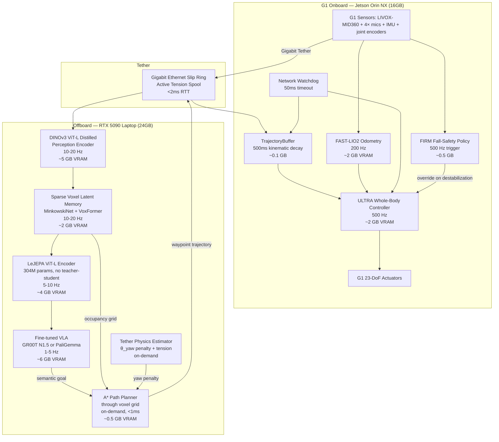

# Revised G1-JEPA Architecture: Descoped, Literature-Backed

*Based on feasibility review and cross-referencing all 42 papers in the wiki vault. Drops 4D-NVS, swaps V-JEPA 2 → LeJEPA, replaces MPPI → A*, integrates ULTRA + FIRM.*

---

## Architecture Diagram



---

## Three-Tier Frequency Decomposition

| Tier | Frequency | Hardware | Components | Latency Budget |
|---|---|---|---|---|
| **Semantic** | 1–5 Hz | RTX 5090 | VLA (GR00T/PaliGemma): language grounding, goal selection | 200–1000 ms |
| **Predictive** | 5–20 Hz | RTX 5090 | DINOv3 + Voxel Memory + LeJEPA + A* planner | 50–200 ms |
| **Reactive** | 200–500 Hz | Orin NX | FAST-LIO2 + ULTRA WBC + FIRM fall-safety + TrajectoryBuffer | 2–5 ms |

---

## Revised Compute Budget

### Offboard: RTX 5090 Laptop (24GB VRAM)

| Component | Model | VRAM | Inference Time | Target Hz | Feasibility |
|---|---|---|---|---|---|
| **Perception** | DINOv3 ViT-L (distilled, ~300M) | ~5.0 GB | ~8–12 ms | 10–20 Hz | ✅ Conservative estimate; TensorRT FP16 |
| **Voxel Memory** | MinkowskiNet encoder + hash grid | ~2.0 GB | ~5 ms (sparse conv) | 10–20 Hz | ✅ Well-established; runs on Orin NX in literature |
| **World Model** | LeJEPA ViT-L (~304M) | ~4.0 GB | ~8–12 ms per forward pass | 5–10 Hz | ✅ No teacher-student overhead; single forward pass |
| **High-Level VLA** | GR00T N1.5 (3B) or PaliGemma (3B) | ~6.0 GB | ~50–200 ms per inference | 1–5 Hz | ✅ Async from planner; batch VLA calls |
| **A* Planner** | Grid search through voxel occupancy | ~0.5 GB | <1 ms per query | On-demand | ✅ Trivial; runs on CPU if needed |
| **Tether Physics** | Yaw estimator + tension model | ~0.2 GB | <0.1 ms | On-demand | ✅ Simple analytical model |
| **CUDA / OS Overhead** | — | ~2.0 GB | — | — | Standard headroom |
| **TOTAL** | | **~19.7 GB** | | | **82% VRAM utilization** |

### Onboard: Jetson Orin NX (16GB Unified)

| Component | Model | Memory | Target Hz | Feasibility |
|---|---|---|---|---|
| **FAST-LIO2** | LiDAR-inertial odometry | ~2.0 GB | 200 Hz | ✅ Deployed on Orin NX in literature |
| **ULTRA WBC** | PPO policy (MLP, ~2M params) | ~2.0 GB | 500 Hz | ✅ MLP inference at 500Hz is trivial; ULTRA validated on G1 |
| **FIRM Fall-Safety** | Diffusion policy (lightweight) | ~0.5 GB | 500 Hz trigger, 50 Hz inference | ✅ FIRM validated on G1; only triggered on destabilization |
| **TrajectoryBuffer** | 500ms kinematic queue | ~0.1 GB | 200–500 Hz | ✅ Simple ring buffer; already skeleton-implemented |
| **Network Watchdog** | Heartbeat monitor | ~0.05 GB | Continuous | ✅ Trivial |
| **OS / ROS 2 Overhead** | — | ~3.0 GB | — | Standard for Orin NX |
| **TOTAL** | | **~7.65 GB** | | **48% memory utilization** |

---

## Key Changes from Original Design

| Original | Revised | Rationale |
|---|---|---|
| V-JEPA 2 (ViT-g, ~1B) | LeJEPA ViT-L (304M) | 3× smaller, better transfer on small datasets, no teacher-student overhead, training loss as model selector |
| MPPI 1024 samples @ 40Hz | A* planner + VLA goal selector | ~1000× less compute; ANS-validated modular decomposition; analytical planner runs in <1ms |
| 4D Neural Voxel Splatting (4GB) | Temporal voxel grid with feature decay | Saves 3.5GB VRAM; 4D-NVS was designed for rendering, not real-time robotics |
| Slot Attention | DINOv3 patch features directly | Only validated on synthetic data; DINO already does emergent segmentation |
| HJI Reachability | FIRM fall-safety + uncertainty damping | HJI in latent space is an open research problem; FIRM is deployed and validated on G1 (10/10 success) |
| Custom WBC/CBF | ULTRA pipeline + HUGWBC intervention | Six G1-validated control papers available; ULTRA provides complete training pipeline |
| Custom VL-JEPA | Fine-tuned VLA (GR00T/PaliGemma) | 94% success on G1 with modality augmentation; simpler monolithic architecture |
| 24.0 GB (95% saturated) | 19.7 GB (82% utilized) | 4.3 GB headroom for batch processing, larger VLA contexts, or future additions |

---

## Data Flow Walkthrough

### Normal Operation (link healthy)

1. **G1 sensors** stream RGB-D + LiDAR + IMU + audio over Gigabit tether to RTX 5090
2. **DINOv3** extracts dense patch features at 10–20 Hz → populates **Sparse Voxel Memory**
3. **LeJEPA** encoder produces latent world state from voxel features at 5–10 Hz
4. **VLA** (GR00T/PaliGemma) receives latent state + language command, produces semantic goal at 1–5 Hz (e.g., "navigate to the charging station while avoiding the blue mat")
5. **A* planner** converts semantic goal + voxel occupancy grid → waypoint trajectory
6. **Tether Physics Estimator** adds λ·θ_yaw² penalty to waypoints to prevent cable entanglement
7. Waypoint trajectory sent over tether → **TrajectoryBuffer** on Orin NX
8. **ULTRA WBC** tracks waypoints at 500Hz with joint position offsets + PD control
9. **FAST-LIO2** provides 200Hz odometry feedback to WBC

### Link Loss (watchdog triggered)

1. Network Watchdog detects >50ms heartbeat gap
2. TrajectoryBuffer consumes remaining 500ms of pre-computed waypoints
3. Velocity commands decay linearly as buffer depletes → zero-velocity double-support stance
4. FIRM monitors for destabilization; if triggered, takes over with fall-recovery policy

### Destabilization (FIRM override)

1. FIRM detects destabilization via IMU + joint encoder threshold (independent of link state)
2. Overrides ULTRA WBC output with fall-prevention / impact-mitigation / recovery action
3. Recovery policy based on diffusion model with adaptive keyframe codebook memory

---

## VRAM Budget vs. Original

```
Original:  ████████████████████████░ 24.0 GB (95% saturated)
           DINOv3(6) + V-JEPA2(8) + 4D-NVS(4) + MPPI(3) + Audio(1) + OS(2)

Revised:   ████████████████░░░░░░░░ 19.7 GB (82% utilized)
           DINOv3(5) + Voxel(2) + LeJEPA(4) + VLA(6) + A*(0.5) + Tether(0.2) + OS(2)
                       ^^^^ 4.3 GB headroom
```

---

## Feasibility Assessment

| Dimension | Original | Revised |
|---|---|---|
| Compute realism | ⭐⭐ Over-optimistic ~100× | ⭐⭐⭐⭐ Conservative estimates |
| VRAM headroom | 5% (1.2 GB) | 18% (4.3 GB) |
| Component maturity | Stubs only | Validated in literature (6 G1 papers) |
| Planning approach | Latent-space MPPI (unproven) | A* through occupancy (proven) |
| Safety layer | HJI (open research problem) | FIRM (deployed on G1) |
| World model complexity | ViT-g + teacher-student | ViT-L, single forward pass |
| Deployability (6 months) | ❌ Not feasible | ⚠️ Ambitious but plausible |
| Deployability (12 months) | ❌ Not feasible | ✅ Feasible with focused team |

---

## 4D Voxel Grid Analysis and Debugging

Because the revised architecture drops 4D-NVS (Gaussian Splatting), it trades human-readable "photorealism" for machine-readable "semantics and occupancy." This is vastly superior for real-time control, but requires different debugging techniques:

1. **PCA Color-Mapping for Semantics (Predator Vision):**
   - Each voxel holds a high-dimensional semantic vector (from DINOv3). By using **PCA (Principal Component Analysis)**, these 1024-dimension vectors can be compressed down to 3 dimensions (RGB).
   - **Result:** Objects with similar semantics automatically glow in the same colors in 3D space, proving instantly whether the robot successfully segmented the scene (e.g., floor is green, chairs are red).

2. **Standard ROS 3D Visualizers:**
   - The sparse voxel grid can be exported as a standard point cloud (`.pcd` or `.ply`) and streamed directly into tools like **Foxglove Studio** or **RViz**.
   - The robot's kinematic skeleton (URDF) can be overlaid inside the grid in real-time to see precisely where the robot thinks it is relative to semantic boundaries.

3. **Uncertainty Heatmaps (Debugging Safety):**
   - The grid utilizes "temporal feature decay." Visualizing the grid as a heatmap based on voxel age/uncertainty provides critical safety insights.
   - **Green** = Freshly seen, high confidence.
   - **Red** = Decayed, high uncertainty (like the blind spot behind the robot).
   - This visually demonstrates exactly *why* and *when* the FIRM fall-safety policy gets triggered by an unknown area.

4. **Raw Occupancy Overlays for A* Planner:**
   - For A* to work, the voxel grid collapses into a simple binary state (walkable vs. obstacle).
   - Visualizing this as a raw 3D block-map perfectly overlays with the A* planner's trajectory. If the trajectory intersects a block, the collision math failure is instantly identifiable.
