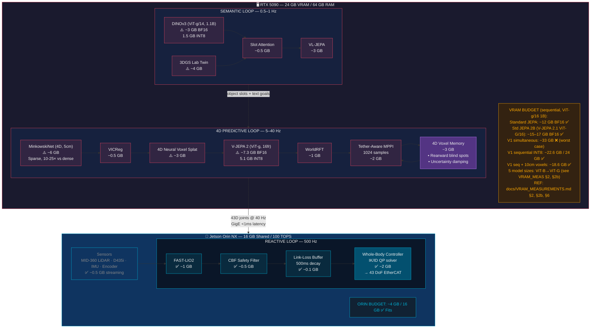
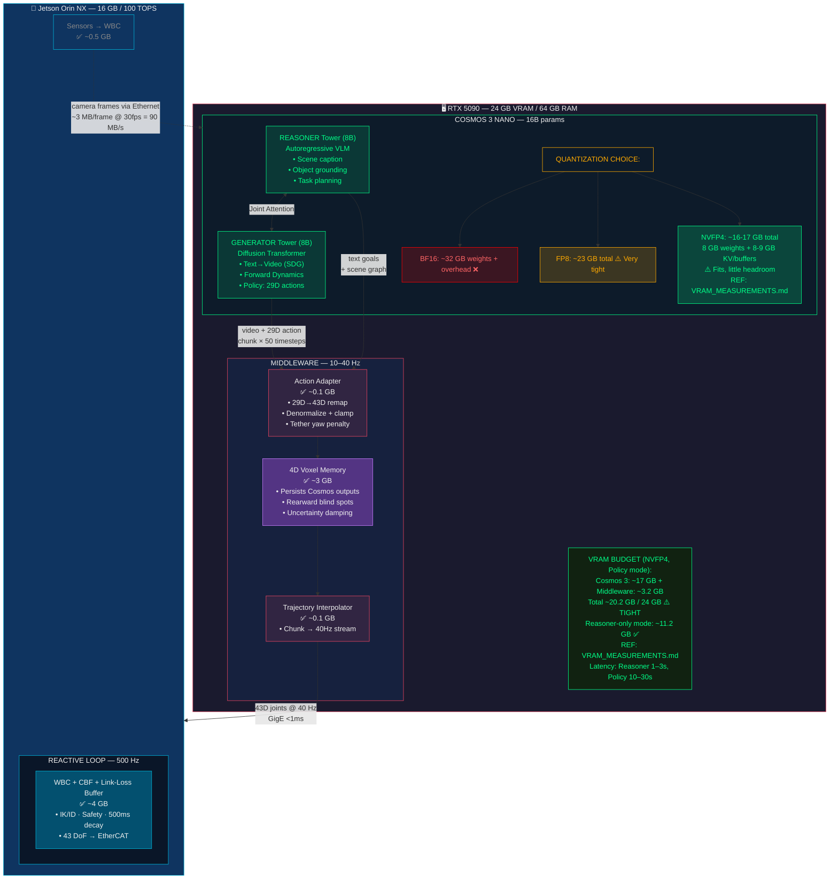
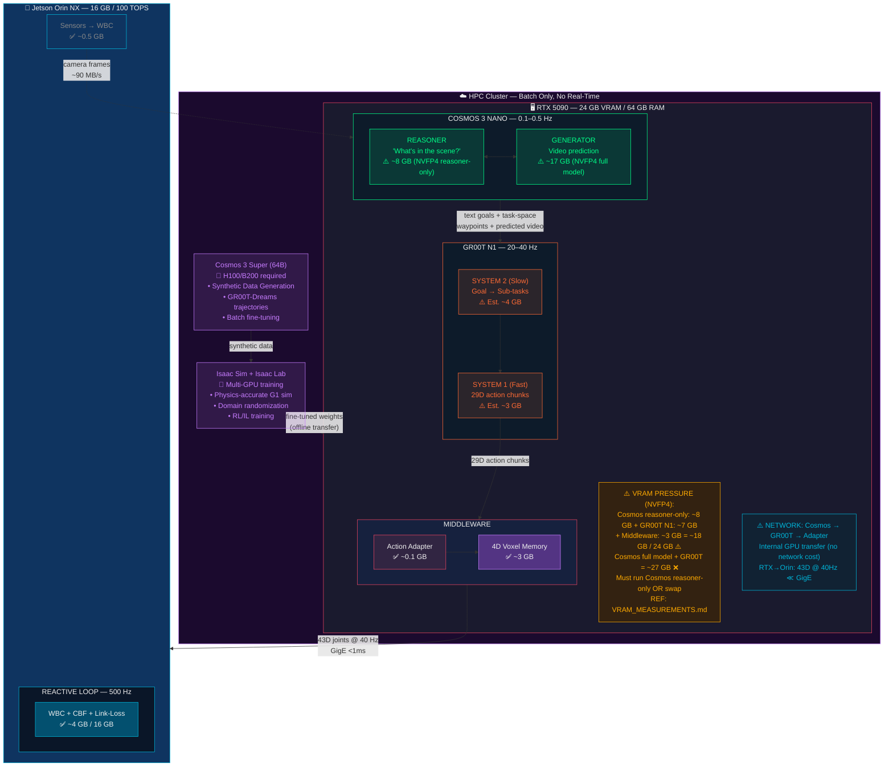
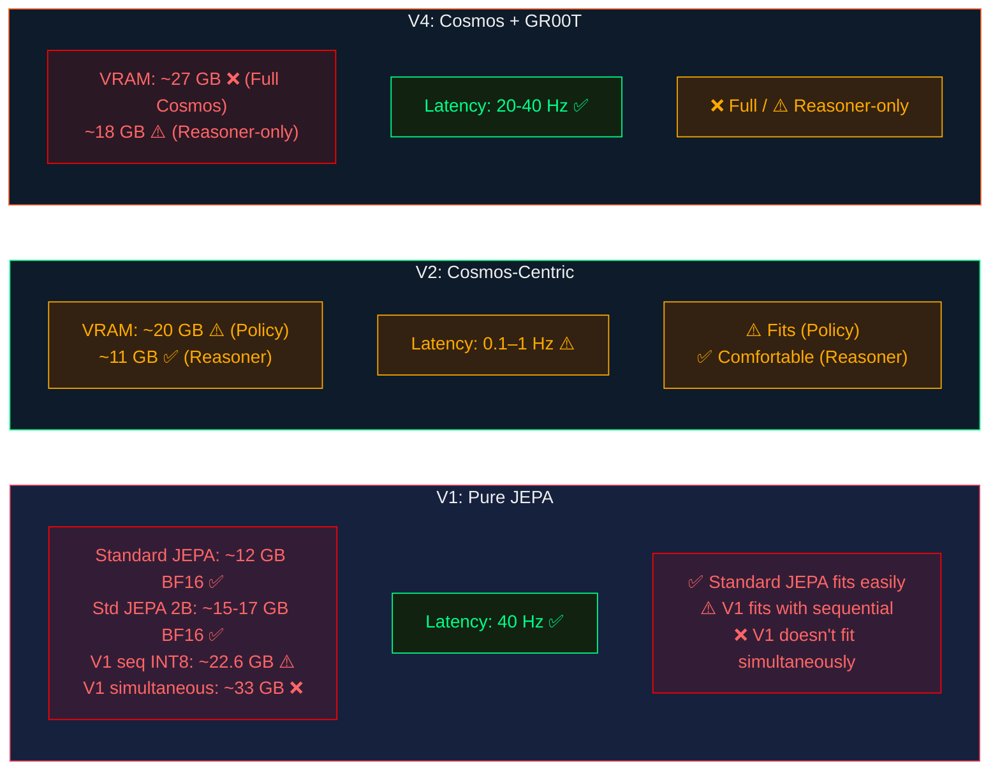

# G1 Pipeline Architecture Variations — Mermaid.js Diagrams

> **📋 VRAM numbers:** All VRAM and model size figures in this document reference [VRAM_MEASUREMENTS.md](./VRAM_MEASUREMENTS.md) (canonical source) and [VRAM_QUICKREF.md](./VRAM_QUICKREF.md) (quick lookup). When in doubt, VRAM_MEASUREMENTS.md is authoritative.

**Date:** June 9, 2026
**Renders in:** GitHub, Obsidian, VS Code (with Mermaid plugin), any Markdown viewer with Mermaid support.

These are the three most important variations from [ARCHITECTURE_VARIATIONS.md](./ARCHITECTURE_VARIATIONS.md), converted to Mermaid flowchart syntax **with hardware feasibility annotations** (VRAM, latency, memory budget, network).

---

## Hardware Reference

| Resource | Capacity | Constraint |
|:---|:---|:---|
| **RTX 5090 VRAM** | 24 GB | All offboard models must fit here |
| **RTX 5090 RAM** | 64 GB | CPU offloading fallback, model weight staging |
| **RTX 5090 Storage** | 2 TB NVMe | Cosmos3-Nano weights ~32 GB download |
| **Orin NX RAM** | 16 GB | Shared CPU/GPU memory; ~4 GB for reactive stack |
| **Orin NX Compute** | 100 TOPS | INT8 inference only; no FP16/BF16 large models |
| **Gigabit Ethernet** | ~125 MB/s | <1 ms latency; camera frames + action targets |
| **HPC Cluster** | Multi-GPU | Batch only; no real-time; for training/SDG |

### Hardware Feasibility Key

| Symbol | Meaning |
|:---|:---|
| ✅ | Fits comfortably |
| ⚠️ | Tight — requires quantization/offloading |
| ❌ | Doesn't fit on this hardware |
| 🔷 | HPC only (batch, no real-time) |

---

## Variation 1: Pure JEPA — The Baseline



**Hardware verdict:** ⚠️ **Fits with sequential execution** (~22.6 GB INT8 / ~24.8 GB BF16). The diagram shows ALL components simultaneously (~33 GB BF16) — this is the worst case. **Standard JEPA** (V-JEPA 2 + MPPI + Voxel = ~12 GB) fits easily on any 24 GB GPU, consistent with published papers. **Standard JEPA with V-JEPA 2.1 ViT-G/16 (2B)**: ~15–17 GB BF16 — best quality, fits any 24 GB GPU comfortably. **Our V1 with sequential loops** (Semantic → unload → Predictive, standard robotics practice) fits at INT8 comfortably. With 10cm MinkowskiNet voxels: ~18.6 GB INT8 ✅. See [VRAM_MEASUREMENTS.md §6](./VRAM_MEASUREMENTS.md#6-corrected-vram-budgets-per-variation) and [§2b](./VRAM_MEASUREMENTS.md#2b-v-jepa-21--dense-feature-upgrade). ✅ Orin NX comfortable (~4 GB / 16 GB).

---

## Variation 2: Cosmos 3-Centric



**Hardware verdict:** ⚠️ **Tight but fits** (~20 GB / 24 GB in Policy mode). Our previous ~8/11 GB estimate was too optimistic — only counted weight VRAM, missed KV cache and CUDA buffers (~8 GB additional). Reasoner-only mode is lighter at ~11 GB. ❌ BF16 won't fit. FP8 is borderline (~23 GB). NVFP4 is mandatory. See [VRAM_MEASUREMENTS.md](./VRAM_MEASUREMENTS.md). ✅ Orin NX comfortable. ⚠️ Camera stream @ 90 MB/s under GigE's 125 MB/s ceiling.

---

## Variation 4: Cosmos 3 + GR00T N1 Hybrid



**Hardware verdict:** ⚠️ **Fits only with Cosmos Reasoner-only** (~18 GB). Full Cosmos + GR00T = ~27 GB ❌. Sequential execution required: keep Cosmos Reasoner resident (~8 GB), swap Generator in/out for world queries. Or: run Cosmos → unload → GR00T → unload → Cosmos. 🔷 HPC required for training. See [VRAM_MEASUREMENTS.md](./VRAM_MEASUREMENTS.md).

---

## Hardware Feasibility Comparison



---

## Detailed Hardware Budget Per Variation

| Resource | V1: Pure JEPA | V2: Cosmos-Centric | V4: Cosmos + GR00T |
|:---|:---|:---|:---|
| **RTX 5090 VRAM** | Std JEPA ~12 GB ✅ / Std JEPA 2B ~15-17 GB ✅ / V1 seq ~22.6 GB ⚠️ / V1 sim ~33 GB ❌ | ~20 GB ⚠️ (Policy) / ~11 GB ✅ (Reasoner) | ~18 GB ⚠️ (Reasoner) / ~27 GB ❌ (Full) |
| **RTX 5090 RAM** | ~10 GB for datasets | ~8 GB for model staging | ~12 GB for model staging |
| **RTX 5090 Storage** | ~5 GB model weights | ~32 GB Cosmos3-Nano download | ~40 GB both models |
| **Orin NX RAM** | ~4 GB / 16 GB ✅ | ~4.5 GB / 16 GB ✅ | ~4.5 GB / 16 GB ✅ |
| **Orin NX Compute** | ~20 TOPS (CBF+WBC) | ~20 TOPS (CBF+WBC) | ~20 TOPS (CBF+WBC) |
| **GigE Bandwidth** | ~5 MB/s (43D@40Hz) | ~5 MB/s + ~90 MB/s camera | ~5 MB/s + ~90 MB/s camera |
| **HPC Required?** | No ✅ | No ✅ | Yes 🔷 (training only) |
| **Quantization Required?** | No (custom models) | Yes — NVFP4 essential | Yes — NVFP4 essential |
| **GPU Sharing?** | All custom, shared | Single model | Two models ⚠️ |

## Network Budget

| Stream | Direction | Bandwidth | Latency Budget |
|:---|:---|:---|:---|
| Camera frames (D435i 720p@30fps) | Orin → RTX 5090 | ~90 MB/s | <5 ms |
| Action targets (43D float32 @ 40Hz) | RTX 5090 → Orin | ~7 KB/s (negligible) | <1 ms required |
| Gigabit Ethernet ceiling | Bidirectional | ~125 MB/s | — |
| **Total camera + actions** | — | ~90 MB/s | ✅ Under ceiling |

## Key Hardware Insights

1. **VRAM is the binding constraint.** The RTX 5090's 24 GB is the ceiling. NVFP4 quantization is mandatory for Cosmos 3. See [VRAM_MEASUREMENTS.md](./VRAM_MEASUREMENTS.md).
2. **Variation 2 (Cosmos-Centric) Reasoner-only is best fit** at ~11 GB — fast scene Q&A without video generation.
3. **Variation 2 Policy mode** uses ~20 GB — fits but very tight.
4. **Variation 1 (Pure JEPA) fits with sequential execution.** Standard JEPA = ~12 GB BF16 ✅, standard JEPA with V-JEPA 2.1 2B = ~15–17 GB BF16 ✅, V1 kitchen sink sequential INT8 = ~22.6 GB ✅. Only V1 simultaneous load (~33 GB) doesn't fit — and no one does that.
5. **Variation 4 only works with Cosmos Reasoner-only** (~18 GB). Full Cosmos + GR00T = ~27 GB ❌.
5. **Orin NX is never the bottleneck** — all variations use ~4 GB / 16 GB for the reactive stack.
6. **Gigabit Ethernet is not a bottleneck** — camera stream (~90 MB/s) + actions (negligible) fit under 125 MB/s.
7. **HPC is only needed for training** (Variation 4 and optionally Variation 8/10). Real-time inference stays on the RTX 5090.

## Color Legend

| Color | Meaning |
|:---|:---|
| 🟢 Green border | NVIDIA Foundation Models (Cosmos 3, GR00T N1) |
| 🔴 Red/Pink | Our custom components (MPPI, Adapter, Interpolator) |
| 🟣 Purple | 4D Voxel Latent Memory (our unique differentiator) |
| 🔵 Cyan | Onboard reactive safety (WBC, CBF, FAST-LIO2) |
| 🟡 Yellow text | Hardware budget warnings |
| ✅ Green check | Fits comfortably |
| ⚠️ Yellow warning | Tight — needs optimization |
| ❌ Red X | Doesn't fit |
| 🔷 Purple diamond | HPC only (batch, offline) |

## Rendering Tips

- **GitHub**: These render natively in any `.md` file — just view the file on GitHub.
- **Obsidian**: Works out of the box. Use ````mermaid` code blocks.
- **VS Code**: Install the "Markdown Preview Mermaid Support" extension.
- **Dark mode**: The diagrams use dark theme colors. For light mode viewers, the text will still be readable (white on colored backgrounds).

## See Also

- **[ARCHITECTURE_VARIATIONS.md](./ARCHITECTURE_VARIATIONS.md)** — All 10 variations, migration pathways, decision guide, and **[Minimum Viable Hardware](./ARCHITECTURE_VARIATIONS.md#minimum-viable-hardware)** section (cheapest GPU per variation, untethered analysis, Jetson Thor upgrade path)
- **[VRAM_MEASUREMENTS.md](./VRAM_MEASUREMENTS.md)** — Real inference VRAM footprints for all models
- **[HARDWARE_RISK_REGISTER.md](./HARDWARE_RISK_REGISTER.md)** — Failure modes and recovery strategies per variation
