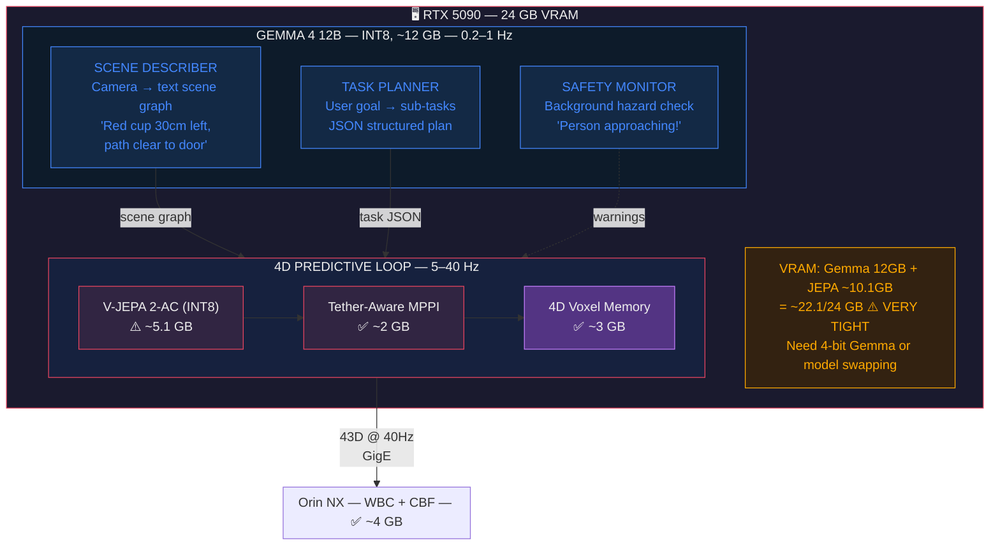
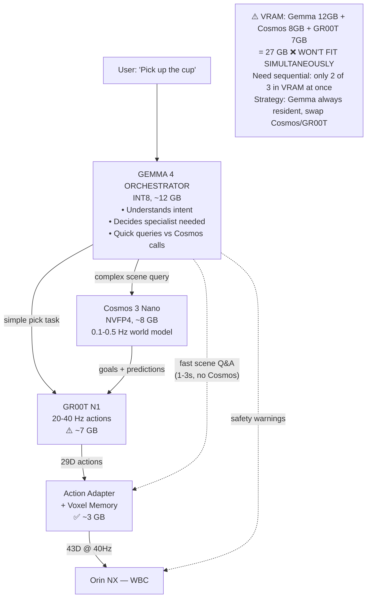
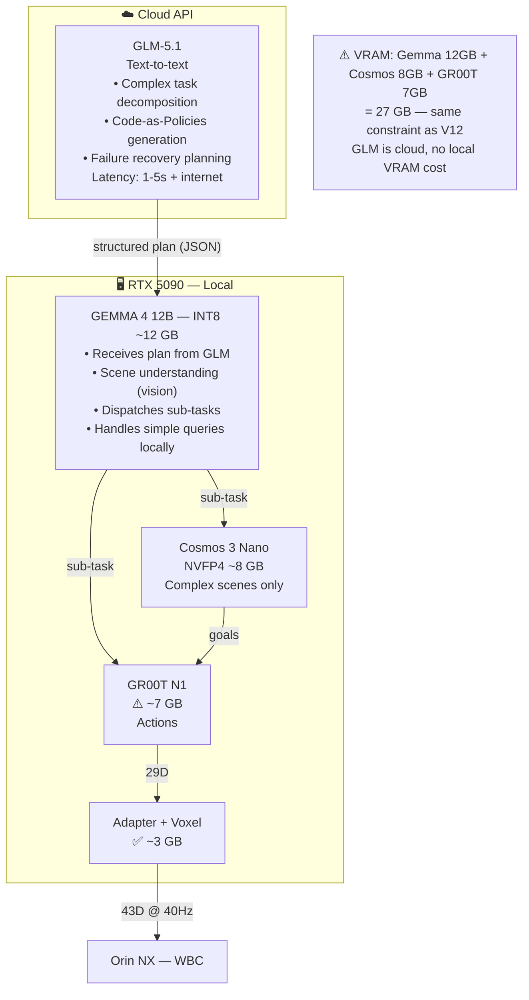
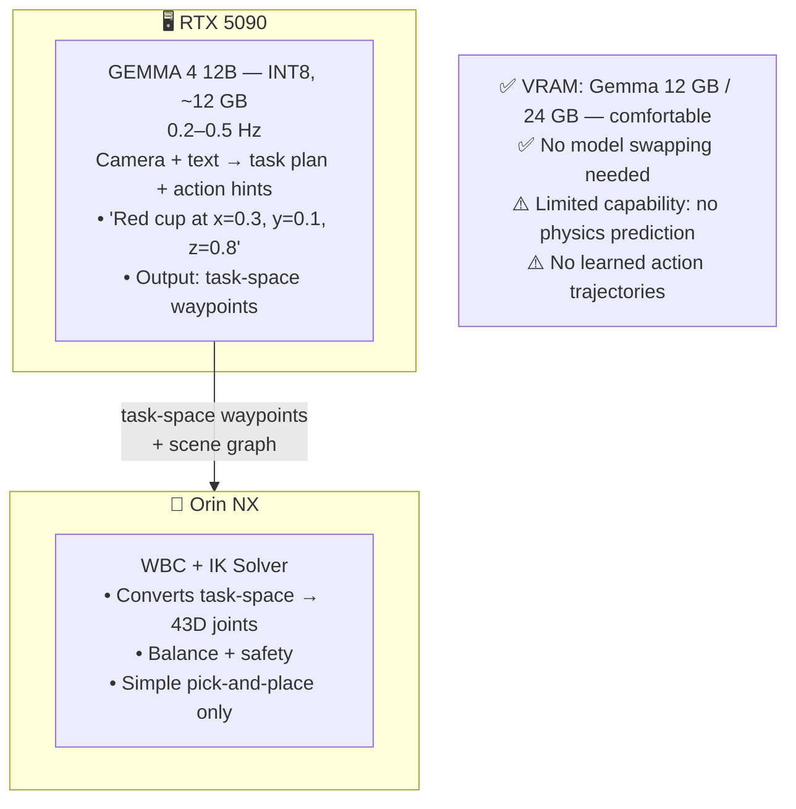

# LLM & VLM Roles in the G1 Pipeline: GLM-5.1 & Gemma 4 12B

> **📋 VRAM numbers:** All VRAM and model size figures in this document reference [VRAM_MEASUREMENTS.md](./VRAM_MEASUREMENTS.md) (canonical source) and [VRAM_QUICKREF.md](./VRAM_QUICKREF.md) (quick lookup). When in doubt, VRAM_MEASUREMENTS.md is authoritative.

**Date:** June 9, 2026
**Context:** Where do general-purpose LLMs/VLMs fit alongside specialized models like Cosmos 3, GR00T N1, and V-JEPA 2?

---

## 1. Model Profiles

### GLM-5.1 (Z.AI / Zhipu AI — March 2026)

| Property | Value |
|:---|:---|
| **Type** | Text-to-text LLM (NO vision) |
| **Access** | API-only (Z.AI cloud) — cannot run locally |
| **Strengths** | Long-horizon planning, agentic coding, complex reasoning, function calling, JSON structured output, MCP support |
| **Weaknesses** | No vision. No spatial reasoning. Cloud latency + internet dependency. API costs. |
| **Benchmarks** | SWE-Bench Pro: 58.4. Claims to beat GPT-5.4 and Claude Opus 4.6 on coding/agent tasks |
| **Relevance to us** | Task decomposition, code generation for robot policies, orchestrator logic |

### Gemma 4 12B (Google DeepMind — June 3, 2026)

| Property | Value |
|:---|:---|
| **Type** | Multimodal VLM (text + vision + audio) |
| **Access** | Open weights — runs locally via Transformers, Ollama, vLLM, llama.cpp |
| **Architecture** | Encoder-free unified model — no separate vision encoder, lower latency |
| **VRAM** | ~16 GB (fits RTX 5090 24GB with headroom) |
| **Quantization** | Full range: INT8, 4-bit via llama.cpp/vLLM |
| **Strengths** | Open, local, multimodal, agentic focus, low latency, skills repository |
| **Weaknesses** | 12B params — less capable than Cosmos 3 (16B) or cloud models. No physics-grounded video prediction. No native action head for robots. |
| **Relevance to us** | Local scene describer, task planner, orchestrator, fast VLM for simple queries |

---

## 2. Where General LLMs/VLMs Fit in Robotics (2026 Patterns)

The field has converged on three main patterns for using LLMs/VLMs in robot pipelines:

### Pattern A: LLM as Task Planner (Decomposer)

```
User: "Clean the lab bench and organize the tools"
          │
          ▼
┌─────────────────────┐
│  LLM (e.g., GLM-5.1)│  ← High-level reasoning
│                     │
│  Output (JSON):     │
│  [{                 │
│    "task": "scan",  │
│    "target": "bench"│
│  }, {               │
│    "task": "pick",  │
│    "target": "screwdriver"│
│  }, ...]            │
└────────┬────────────┘
         │ structured sub-tasks
         ▼
┌─────────────────────┐
│  Robot Pipeline     │  ← Executes each sub-task
│  (Cosmos/GR00T/JEPA)│
└─────────────────────┘
```

**Role:** The LLM never sees the world or outputs motor commands. It takes a high-level goal and decomposes it into structured sub-tasks that the robot pipeline can execute.

### Pattern B: VLM as Scene Describer

```
Camera feed (D435i)
         │
         ▼
┌─────────────────────┐
│  VLM (e.g., Gemma 4)│  ← Multimodal understanding
│                     │
│  Output:            │
│  "Red cup on table  │
│   30cm left of robot│
│   Blue plate empty  │
│   Path to door clear"│
└────────┬────────────┘
         │ semantic scene graph
         ▼
┌─────────────────────┐
│  Action Model       │  ← Uses scene understanding
│  (GR00T N1 / MPPI)  │
└─────────────────────┘
```

**Role:** The VLM ingests the robot's camera feed and outputs a structured scene description. This feeds into the action model. Faster than Cosmos 3 Generator for simple scene queries.

### Pattern C: LLM as Orchestrator (Manager-Worker)

```
┌──────────────────────────────────────────┐
│  ORCHESTRATOR LLM (Gemma 4 or GLM-5.1)   │
│                                           │
│  "What does the user want?"              │
│  "Which specialist should handle this?"  │
│  "What's the next step?"                 │
└────┬──────────┬──────────┬───────────────┘
     │          │          │
     ▼          ▼          ▼
┌─────────┐┌─────────┐┌─────────┐
│ Cosmos 3││ GR00T N1││ V-JEPA 2│
│ (world) ││ (action)││ (predict)│
└─────────┘└─────────┘└─────────┘
```

**Role:** The LLM doesn't do perception or action — it decides WHICH specialist model to invoke, with what prompt, and in what order. This is the "brain" that coordinates the specialized models.

---

## 3. What GLM-5.1 Could Do For Us

### Best Role: Remote Task Planner + Code Generator

GLM-5.1 is a text-only cloud model. It can't see the robot's camera. But it excels at:

**1. Complex Task Decomposition**
```
Input:  "Reorganize the lab — move all tools to the red toolbox, 
         cables to the drawer, and clear the workbench."
Output: {
  "plan": [
    {"step": 1, "action": "scan", "target": "workbench", "expected": ["tools", "cables", "objects"]},
    {"step": 2, "action": "classify", "items": ["tools", "cables"], "destinations": {"tools": "toolbox", "cables": "drawer"}},
    {"step": 3, "action": "pick", "target": "screwdriver", "destination": "toolbox"},
    ...
    {"step": 8, "action": "verify", "target": "workbench", "condition": "empty"}
  ],
  "estimated_time": "4-6 minutes",
  "safety_notes": ["Keep clear of power cables during step 5"]
}
```

**2. Code-as-Policies Generation**
```
Input:  "Write a Python function that makes the G1 walk forward 2 meters, 
         stopping if the LiDAR detects an obstacle within 50cm."
Output: def walk_forward_with_safety(distance_m=2.0, stop_threshold_cm=50):
           while distance_traveled < distance_m:
               lidar_reading = g1.get_lidar_forward()
               if lidar_reading < stop_threshold_cm:
                   g1.stop()
                   return False
               g1.walk_forward(step_size=0.1)
           return True
```

**3. Failure Recovery Planning**
```
Input:  "The G1 failed to pick up the red cup — the gripper slipped.
         Current state: cup on floor, robot standing 40cm away."
Output: {
  "diagnosis": "Grip force insufficient for cup surface material",
  "recovery": [
    {"step": 1, "action": "crouch", "note": "Lower CoM for floor reach"},
    {"step": 2, "action": "pick", "target": "cup", "grip_force": "high", "approach": "from_above"},
    {"step": 3, "action": "stand", "note": "Return to nominal height"}
  ]
}
```

### Where GLM-5.1 Does NOT Fit

- ❌ Real-time scene understanding (no vision)
- ❌ Direct motor control (text-only output)
- ❌ Physics-grounded prediction (no world model)
- ❌ Any task requiring < 1 second latency (cloud API)
- ❌ Offline operation (requires internet)

### Hardware Note
GLM-5.1 is API-only. No local VRAM. Latency depends on Z.AI's servers (estimate 1-5 seconds per request). API costs apply.

---

## 4. What Gemma 4 12B Could Do For Us

### Best Role: Local Multimodal Brain

Gemma 4 12B is open, multimodal, and fits on our RTX 5090. It's the most practical general-purpose model for our pipeline.

**1. Fast Scene Description (Low Latency)**
```
Camera (D435i, 720p) → Gemma 4 → 
  "The workbench has a red screwdriver on the left, 
   a blue multimeter center, and scattered cables on the right.
   The floor in front of the robot is clear for 2 meters.
   A person is visible 3 meters ahead, stationary."
Latency: ~1-3 seconds on RTX 5090 (FP8)
```

This replaces the DINO + Slot Attention + VL-JEPA pipeline for scene understanding with a single model call.

**2. Task Planning with Vision Grounding**
```
User: "Pass me the multimeter" + Camera feed
       │
       ▼
Gemma 4: "Target: blue multimeter, center of workbench, ~50cm from robot.
          Plan: extend right arm 40cm forward, open gripper, close gripper,
          retract arm, extend toward user."
```

**3. Safety Monitoring**
```
Continuous: Camera feed @ 0.2 Hz → Gemma 4 →
  "SAFE: clear path" / 
  "WARNING: person approaching from left, 2m" /
  "DANGER: object fell on floor in footpath"
```

Runs as a background safety check between Cosmos 3 calls.

**4. Orchestrator for Specialized Models**
```
Gemma 4 (orchestrator):
  User says "pick up the red cup" →
  • Query: Is this a simple pick? → YES
  • Dispatch: GR00T N1 (fast, no Cosmos needed)
  
  User says "reorganize the entire lab bench" →
  • Query: Is this a complex multi-step task? → YES
  • Dispatch: Cosmos 3 (needs world understanding + prediction)
  • Then: GR00T N1 per sub-task
```

### Where Gemma 4 Does NOT Fit

- ❌ Physics-grounded video prediction (Cosmos 3 does this)
- ❌ Native action trajectory generation (GR00T N1 or Cosmos Policy mode)
- ❌ 40Hz predictive loop (too slow at 1-3 seconds per call)
- ⚠️ Complex multi-step planning (12B is smaller than cloud models — may need GLM-5.1 for very complex tasks)

### Hardware Feasibility

| Config | VRAM | Fits RTX 5090? | Latency |
|:---|:---|:---|:---|
| Gemma 4 12B (FP16) | ~24 GB | ❌ Barely — no headroom | — |
| Gemma 4 12B (INT8) | ~12 GB | ✅ 12 GB free for other models | ~1-3s |
| Gemma 4 12B (4-bit) | ~6 GB | ✅ 18 GB free | ~0.5-2s |
| **Gemma 4 INT8 + Cosmos 3 NVFP4** | **~20 GB** | **⚠️ Tight but possible** | — |

---

## 5. New Architecture Variations Using LLMs/VLMs

### Variation 11: Gemma 4 as Semantic Brain

Gemma 4 replaces the Semantic loop entirely. Faster and simpler than Cosmos 3, but no physics-grounded prediction.



**Pros:** Open model, fully local, fast (~1-3s), multimodal (vision+text+audio). Simpler than Cosmos 3.
**Cons:** No physics-grounded prediction. 12B less capable than Cosmos 3's 16B. ⚠️ VRAM extremely tight with JEPA stack.
**When to use:** Simple scene understanding. Fast queries between Cosmos calls. Offline-first operation.

---

### Variation 12: Gemma 4 Orchestrator + Cosmos 3 Worker

Gemma 4 manages the conversation and dispatches to Cosmos 3 only when needed. Best balance of speed and capability.



**Pros:** Gemma handles 80% of queries fast. Cosmos 3 only invoked for complex tasks. GR00T for actions.
**Cons:** ❌ All three models don't fit simultaneously on 24 GB. Need model swapping or CPU offloading. More complex orchestration logic.
**When to use:** When we want the best of both worlds — fast local VLM + powerful world model — but accept the VRAM constraint.

---

### Variation 13: GLM-5.1 Cloud Planner + Local Gemma 4

Cloud LLM for complex multi-step planning. Local Gemma for fast scene understanding and execution coordination.



**Pros:** GLM-5.1 is elite at complex planning. No local VRAM cost for GLM (cloud). Gemma handles everything local.
**Cons:** Internet dependency for complex tasks. API costs. GLM can't see camera — must trust Gemma's scene description. Same VRAM constraint as V12.
**When to use:** Complex autonomous operation ("reorganize the lab"). When GLM's coding/planning capability justifies the cloud dependency.

---

### Variation 14: Gemma 4 Standalone (Minimal VLM Pipeline)

The simplest possible VLM-based pipeline. No Cosmos, no GR00T, no JEPA. Just Gemma 4 + WBC.



**Pros:** Simplest possible VLM pipeline. Fast to implement (~days). Fully local. Comfortable VRAM. Good for basic pick-and-place.
**Cons:** No physics prediction. No learned motor skills. Task-space only — no whole-body coordination for complex locomotion.
**When to use:** Rapid prototype. Baseline to beat. Simple manipulation tasks.

---

## 6. Comparison: All Models in Our Pipeline

| Model | Type | VRAM | Local? | Vision? | Actions? | Physics? | Best Role |
|:---|:---|:---|:---|:---|:---|:---|:---|
| **Cosmos 3 Nano** | World Foundation | ~8 GB (Reasoner) / ~17 GB (Policy) NVFP4 | ✅ | ✅ | ✅ (29D) | ✅ | World model + action generation |
| **GR00T N1** | VLA | ~7 GB (est.) | ✅ | ✅ | ✅ | ⚠️ limited | Motor action generation |
| **V-JEPA 2** | World Model | ~7.3 GB BF16 / ~5.1 GB INT8 | ✅ | ✅ | ⚠️ (AC) | ✅ | Fast 40Hz prediction |
| **Gemma 4 12B** | VLM | ~12 GB (INT8) | ✅ | ✅ | ❌ | ❌ | Scene describer + orchestrator |
| **GLM-5.1** | LLM | 0 (cloud) | ❌ | ❌ | ❌ | ❌ | Complex task planner + code gen |
| **π0** | VLA | ~6 GB (3B) | ✅ | ✅ | ✅ (flow) | ❌ | Dexterous manipulation |

### VRAM Co-Residency Matrix (Updated — see VRAM_MEASUREMENTS.md)

Which combinations fit on the RTX 5090 (24 GB) simultaneously?

| Combination | Total VRAM | Fits? |
|:---|:---|:---|
| Cosmos 3 Reasoner-only (NVFP4) + Voxel + Adapter | ~11 GB | ✅ |
| Cosmos 3 Policy (NVFP4) + Voxel + Adapter | ~20 GB | ⚠️ Tight |
| Cosmos 3 Reasoner + GR00T N1 | ~15 GB | ✅ |
| Cosmos 3 Policy + GR00T N1 + Voxel + Adapter | ~27 GB | ❌ Won't fit |
| Cosmos 3 Policy + GR00T N1 (no middleware) | ~24 GB | ⚠️ Extremely tight |
| Gemma 4 (INT8) + Cosmos 3 Reasoner | ~20 GB | ⚠️ Tight |
| Gemma 4 (INT8) + Cosmos 3 Policy | ~29 GB | ❌ Won't fit |
| Gemma 4 (INT8) + GR00T N1 | ~19 GB | ⚠️ Tight |
| Gemma 4 + Cosmos 3 Policy + GR00T N1 | ~36 GB | ❌ Won't fit |
| Gemma 4 (4-bit) + Cosmos 3 Reasoner + GR00T N1 | ~21 GB | ⚠️ Tight |
| Gemma 4 (INT8) + V-JEPA 2 (INT8) + MPPI + Voxel | ~22 GB | ⚠️ Very tight |
| Cosmos 3 Policy + V-JEPA 2 (INT8) + MPPI + Voxel | ~27 GB | ❌ Won't fit |
| Gemma 4 standalone (INT8) | ~12 GB | ✅ Comfortable |

---

## 7. Strategic Recommendations

### For Our Pipeline, Gemma 4 12B Is the More Practical Choice

| Factor | Gemma 4 12B | GLM-5.1 |
|:---|:---|:---|
| **Runs locally** | ✅ On RTX 5090 | ❌ Cloud only |
| **Sees the world** | ✅ Multimodal (vision+text+audio) | ❌ Text only |
| **No internet needed** | ✅ | ❌ |
| **No API costs** | ✅ | ❌ Pay per token |
| **Open weights** | ✅ Can fine-tune on G1 data | ❌ API only |
| **Latency** | 1-3s (local) | 1-5s + network |
| **Complex planning** | ⚠️ Good for simple/medium tasks | ✅ Elite for complex multi-step |
| **VRAM cost** | ~12 GB | 0 (cloud) |

### Recommended Usage

1. **Gemma 4 12B as the default Semantic brain** — replaces DINO + Slot + VL-JEPA for scene understanding. Faster and simpler. Use INT8 or 4-bit to leave VRAM for other models.

2. **GLM-5.1 as an optional cloud upgrade** — for complex autonomous tasks that need elite planning. Not part of the core real-time loop. Invoked only when Gemma 4 determines a task is too complex for local reasoning.

3. **Gemma 4 + Cosmos 3 is the sweet spot** — Gemma handles fast queries (1-3s), Cosmos handles physics-grounded prediction (10-30s). They fit together on the RTX 5090 (~20 GB total).

4. **Avoid putting Gemma + Cosmos + GR00T in VRAM simultaneously** — that's 27 GB, which doesn't fit. Use sequential execution: keep Gemma resident, swap Cosmos/GR00T as needed.

### Updated Architecture Migration Path

```
Variation 1 (Pure JEPA)
    │
    ├──→ Variation 14 (Gemma 4 Standalone)  ← Quickest new path
    │         │
    │         └──→ Variation 11 (Gemma + JEPA)
    │
    ├──→ Variation 2 (Cosmos-Centric)
    │         │
    │         └──→ Variation 12 (Gemma Orchestrator + Cosmos Worker)
    │                   │
    │                   └──→ Variation 13 (+ GLM-5.1 Cloud Planner)
    │
    └──→ Variation 4 (Cosmos + GR00T)
              │
              └──→ Variation 13 (+ GLM-5.1 Cloud Planner)
```
