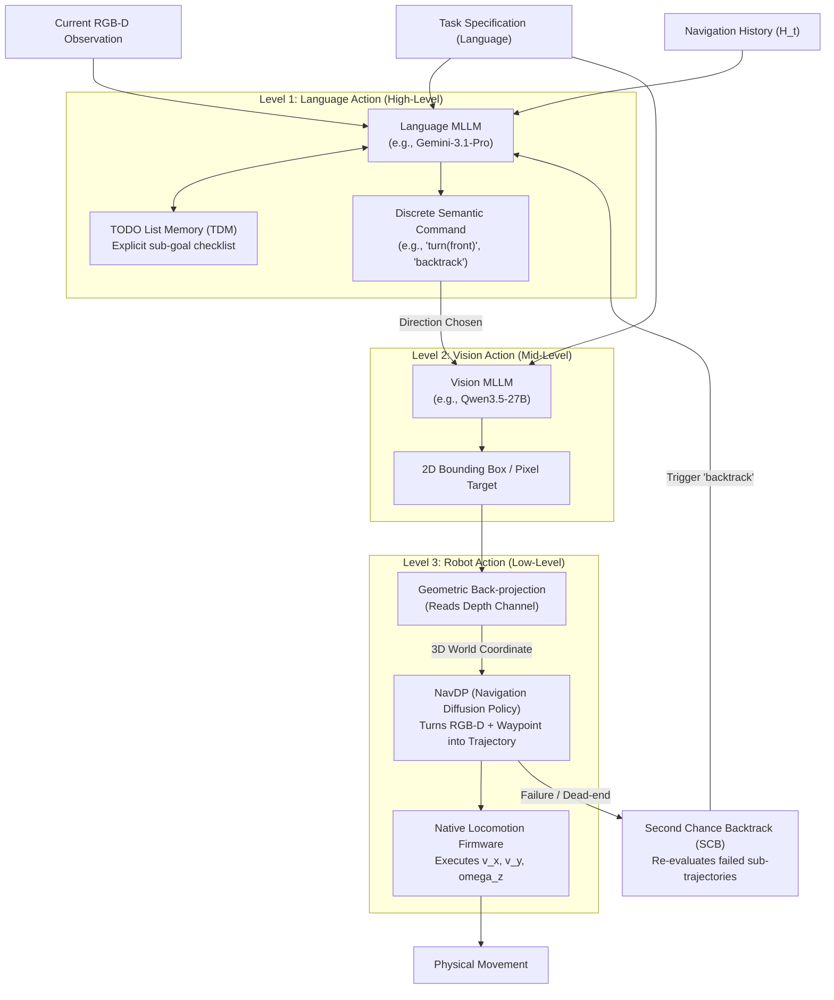

# Uni-LaViRA: Architecture Breakdown & Analysis
**(Paper ID: 2605.27582v1 - May 2026)**

## 1. Executive Summary
Uni-LaViRA (Language-Vision-Robot Actions Translation) proposes a radical departure from the current trend of training massive, monolithic Vision-Language-Action (VLA) models like GR00T. 

Instead of treating navigation and action as a massive data-scaling problem requiring millions of robot trajectories, Uni-LaViRA is a **zero-shot, training-free architecture**. It decomposes the robot's decisions into three distinct abstraction levels—Language, Vision, and Robot Control—allowing it to utilize standard off-the-shelf multimodal LLMs (like Gemini 3.1 Pro and Qwen 3.5) to achieve State-of-the-Art (SOTA) navigation performance without a single hour of robot-specific GPU training.

---

## 2. Architecture Connectograph

---

## 3. The 3-Level "LaViRA" Decomposition

The core philosophy is that navigation is largely "contact-free" and thus falls inside the natural reasoning capabilities of existing MLLMs, negating the need for custom VLA networks.

1. **Language Action (High-Level Planning):** Consumes the user instruction, a 4-view panoramic image, and history. It outputs a semantic direction (front, left, right, back, up, down) rather than exact coordinates. 
2. **Vision Action (Mid-Level Visual Grounding):** Takes the direction chosen by the Language Model, looks at the specific camera view for that direction, and draws a 2D bounding box around the semantic target (e.g., "doorway to the bedroom").
3. **Robot Action (Low-Level Control):** This is where the physical execution happens. First, the system takes the center pixel of the bounding box and reads the laser depth map to calculate a raw 3D coordinate. In the real-world ground robots, this 3D coordinate is passed to **NavDP** (Navigation Diffusion Policy). 
   - **How NavDP works:** NavDP is a specialized local planner that takes the current RGB-D camera view and the target 3D coordinate, and generates a smooth, short-horizon physical trajectory in the robot's local frame. 
   - **The Final Handoff:** NavDP converts this trajectory into basic velocity commands ($v_x$, $v_y$, $\omega_z$), which are fed directly into the robot's *native factory firmware*. The AI does not control the joints—it simply sets the velocity, and the robot's built-in reflexes handle the balancing and stepping.

---

## 4. Key Agentic Loop Mechanisms

Uni-LaViRA solves the classic problems of MLLM hallucinations and forgetfulness using two brilliant prompt-engineering mechanisms:

* **TODO List Memory (TDM):** Instead of feeding the MLLM a massive, scrolling conversation history (which causes "attention drift" on long tasks), TDM forces the agent to maintain an explicit JSON checklist of sub-goals. At every step, the agent must mark items as `pending` or `completed`.
* **Second Chance Backtrack (SCB):** When a monolithic VLA fails, it usually just repeats the same mistake and gets stuck. SCB detects when a path fails (e.g., a dead end), geometrically reverses the robot to the previous waypoint, and feeds the *failed trajectory* back into the Language Model. The MLLM is explicitly prompted to analyze *why* the last choice failed before making a new one.

---

## 5. Real-World G1 Deployment Proof

The authors explicitly validated Uni-LaViRA on the **Unitree G1 humanoid**.

- **Hardware Setup:** 4x Orbbec Gemini 336L RGB-D cameras for panoramic vision.
- **Compute:** Jetson Orin NX running onboard.
- **Models:** `Qwen3.5-9B-Q4` (quantized) acting locally as both the Language Action and Vision Action models.
- **Execution:** Vision Action output (3D waypoints) was fed directly into the G1's native locomotion controller at 1 Hz ($v_x, v_y, \omega_z$).
- **Key Result:** They achieved successful outdoor Vision-and-Language Navigation (VLN) **without any gait re-training**. The G1's native balance controller handled the stepping while the zero-shot MLLM handled the spatial reasoning.

---

## 6. Uni-LaViRA vs. GR00T N1.7 (Which to choose?)

Does this mean we should abandon GR00T? It depends entirely on the task type.

| Feature | Uni-LaViRA | GR00T N1.7 | Verdict for our G1 |
|---|---|---|---|
| **Training Required** | **Zero.** Plug-and-play API calls. | Thousands of demonstrations. | **Uni-LaViRA wins** for rapid prototyping without a data pipeline. |
| **Compute Overhead** | Very high latency (requires API round-trips for Gemini/Qwen). | **~57 Hz** on RTX 5090 (compiled TensorRT). | **GR00T wins** for real-time responsiveness. |
| **Task Specialty** | **Navigation & Exploration** (Contact-free spatial reasoning). | **Dexterous Manipulation** (Contact-rich physics). | **Hybrid approach needed.** |
| **VRAM Footprint** | Extremely low (if using APIs) or ~14GB (if running Qwen locally). | ~10-12GB resident (FP16). | Both fit perfectly in our V2 Orchestrator. |

### Conclusion for our Architecture
You do **not** need to abandon GR00T. In fact, Uni-LaViRA perfectly maps to our existing **V2 Dynamic Orchestrator**:
- **Mode 1 & Mode 4 (Transit & Search):** We should absolutely adopt the Uni-LaViRA architecture. Using Gemini/Qwen for the "Language" and "Vision" actions combined with our Orin NX's local planners is the ultimate way to handle exploration without training data.
- **Mode 3 (Manipulation):** Uni-LaViRA explicitly admits it cannot do contact-rich manipulation (where forces and torques matter). We **must** stick to GR00T N1.7 for precise arm/hand control.
